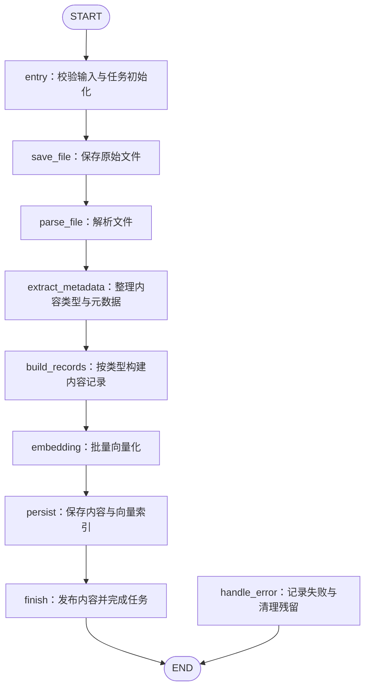
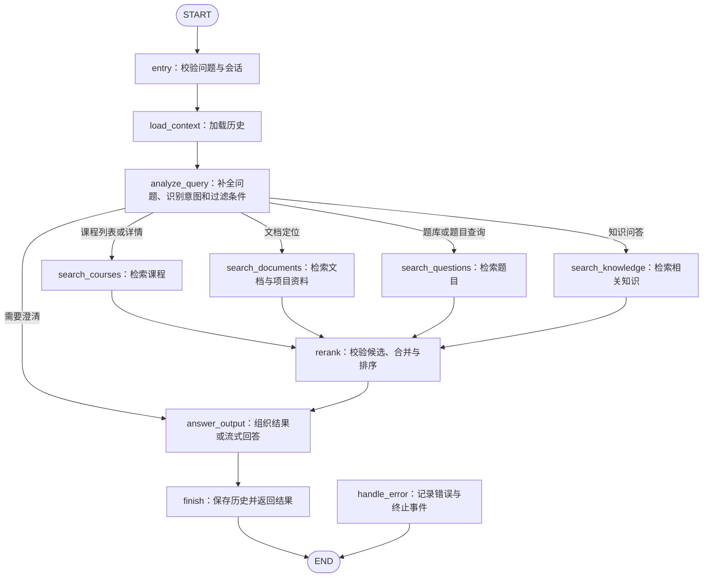

# 教育智库实战

面向教育培训场景，导入课程资料、项目文档、教学讲义和题库，提供课程查询、文档检索、题目检索与知识问答。

> 本文介绍项目架构、存储结构和两个 LangGraph 流程。原始需求见 [需求说明.md](需求说明.md)；开发规则、工具待办与当前进度统一见 [节点开发交接.md](节点开发交接.md)。

当前导入仅实现 `entry`（1/9，待审核），查询节点 0/11；完整流程、API 和真实服务联调尚未完成。Schema 已定义，不代表已经在数据库建表。

## 0. 接手顺序与当前进度

新会话先读本文了解架构，再读 [节点开发交接.md](节点开发交接.md) 按当前进度开发；业务需求以 [需求说明.md](需求说明.md) 为准。文档只记录当前结论，不保留已被替代的实施方案。

| 工作项 | 当前状态 | 证据与下一步 |
| --- | --- | --- |
| 需求、数据样本、技术分层 | 已确认 | 教育业务；LangGraph 两个图；三类向量集合；系列/子课程分层 |
| Milvus Schema | 定义已完成，服务端未验证 | 三套 Schema 和索引函数存在；不代表集合已经创建 |
| 配置与必要调用方 | 离线适配完成 | 本次复核 18 个 test.test_config 测试全部通过；保留已有修复，不重新照旧问题清单覆盖 |
| 公共工具改造 | 部分完成 | 配置、异步日志及 entry 所需执行包装/内存任务适配已离线验证；SSE、历史及其他存储错误语义仍待改 |
| 共享业务模型、解析器、构建器、业务仓储 | 待开发 | 先实现可离线验证的公共模型与真实 MD 规则解析 |
| 导入图 / 查询图 | 原骨架已审核；本轮 State/Schema/entry 调整待复审 | 导入 1/9（entry），查询 0/11；当前 5 个简明自测案例通过；历史版本曾验证单节点图接入，未跑完整导入流程 |
| API / 前端 / 真实服务联调 | 待开发或待验证 | API 入口尚不存在；模型推理、数据库、对象存储集成不能标记已通过 |

**节点开发只改当前节点和必要 common/prompt 提示词：先检索并调用现有 common/utils，不自动修改配置、日志、Schema 或已有工具；发现缺口先反馈并单独取得授权。节点不重复创建客户端、读取配置或复制已有工具实现。** 专属单节点的简单业务逻辑可留在节点内，不要求把所有函数改成类。

**导入 state.py/main_graph.py 已由用户明确审核通过；本轮仅交付 entry 及必需公共能力，停下等待 entry 审核。** 每次只完成一个节点及必要 common/prompt 提示词，冻结配置与公共工具，验证后交用户审核，通过后才能继续下一个。检索流程开始时同样先交 state.py/main_graph.py。单节点自测放在本节点的 `if __name__ == "__main__":` 中，完整流程测试在该流程完成后放入 test/。详细规则见交接文档第 2 节。直接修改源文件，不初始化 Git 或创建分支。

## 1. 总体架构与本期范围

后端使用 FastAPI 提供接口，使用 LangGraph 的 `StateGraph` 编排两个独立流程：

| 流程 | 入口目录 | 主要职责 |
| --- | --- | --- |
| 文件导入 | `processor/import_processor/` | 接收资料、解析、整理元数据、构建内容记录、向量化、入库、追踪任务 |
| 问题检索 | `processor/query_processor/` | 加载对话、理解问题、按意图检索、重排、组织结果或生成回答、保存历史 |

本期覆盖课程列表与详情、课程/项目文档检索、题库与题目查询、知识问答，以及单轮、多轮、流式输出、历史记录和基础异常处理。

管理后台、增量更新、权限与多租户、学习路径推荐、能力测评、视频和多模态检索属于后续扩展，不加入首版流程。

### 建议技术分工

以下沿用参考项目已有依赖提出，属于实现建议，需求文档没有限定这些具体产品：

| 组件 | 建议职责 |
| --- | --- |
| FastAPI | 参数校验、上传、任务查询、问答接口、SSE 事件输出 |
| LangGraph | 流程状态、节点调用、条件路由、错误分支 |
| MongoDB | 只保存按 session_id 关联的聊天历史；不保存导入任务、课程或题目 |
| Milvus | 完整课程/题目/文档片段、过滤字段、1024 维稠密及稀疏向量 |
| MinIO | 原文件、图片、超长完整记录 JSON、导入成功清单；Milvus 保存对象键 |
| Embedding / Reranker / LLM | 向量化、相关性重排、意图与信息抽取、基于证据回答 |

Milvus 同一行同时保存完整业务内容与检索向量。content 是参与向量化的检索文本，record_payload 保存未经摘要/截断的完整课程或题目；超过 JSON 预算则保存 MinIO JSON 对象键。任务进度只在 utils/task_utils 的单进程内存中管理，服务重启后丢失。MongoDB 只保存会话消息。

## 2. 内容模型与来源信息

### 2.1 内容类型

| `content_type` | 对应需求 | 整理方式 |
| --- | --- | --- |
| `course_intro` | 课程介绍、课程详情 | 一门课程的介绍记录关联章节目录、先修要求、适用人群、学习目标和实战项目 |
| `document_chunk` | 课程文档、教学讲义 | 按标题、章节和段落切分，保留位置与上下文关联 |
| `project_material` | 项目文档、项目步骤 | 按章节和步骤切分，保留课程及项目归属 |
| `question` | 题库与题目 | 一道题一条完整记录，题干、选项、答案、解析保持关联 |

题目超过模型输入长度时，可以建立关联的检索片段，但用户返回结果仍读取完整题目。课程详情和章节目录也不能只靠若干文本片段拼接恢复。

### 2.2 共享字段

| 字段 | 含义与约束 |
| --- | --- |
| `record_id` / `document_id` / `task_id` | 内容记录、来源文档、导入任务的内部标识 |
| `content_type` / `content` | 内容类型与正文，入库必填 |
| `series_id` / `series_name` | 课程系列编码与名称；与子课程分层保存 |
| `course_id` / `course_name` | 子课程编码与名称；有归属时填写，区分同名课程 |
| `project_id` / `project_name` | 项目标识与名称，按内容需要填写 |
| `chapter_id` / `chapter_name` | 章节标识与名称，按内容需要填写 |
| `question_bank_id` / `question_bank_name` | 题库标识与名称，题目内容使用 |
| `question_code` / `question_type` | 原题编码与题型；原题编码缺失时保留为空，使用内部 `record_id` 定位 |
| `source_file_name` / `source_object_key` | 来源文件名与原文件对象键，文件导入必填 |
| `source_locator` | 页码、标题路径、表格行号等定位信息，按解析能力填写 |
| `source_url` | 原始资源链接，如有则保存；下载时生成临时访问链接 |
| `metadata_origin` | 元数据来源：上传参数、原文提取、模型提取等，便于排查归属问题 |

课程记录额外保存 `summary`、`audience`、`learning_goals`、`prerequisites`、`chapters`、`projects`；题目记录额外保存 `stem`、`options`、`answer`、`analysis` 和知识点。非选择题允许没有选项，资料未提供的答案、解析和课程详情字段允许缺失，并明确标注。

结构化字段遵循“上传者明确提供 > 原文明确记载 > 模型辅助提取”的顺序；发现冲突时记录警告。模型不得凭空补全课程归属、题目答案或先修要求。

### 2.3 Milvus 三集合结构

按照实际数据和查询方式，采用三个独立集合。课程文档和项目文档共用文档切片集合；每个集合均包含 BGE-M3 的 1024 维稠密向量与模型生成的稀疏向量。完整课程层级、题干/选项/答案/解析存入 record_payload；普通长度一条记录对应一个向量片段。

| 集合 | 环境变量 | 一行的含义 | 主要检索 |
| --- | --- | --- | --- |
| `education_courses` | `COURSES_COLLECTION` | 一个课程系列或子课程的检索片段 | 课程发现、推荐、详情定位 |
| `education_document_chunks` | `DOCUMENT_CHUNKS_COLLECTION` | 一段课程讲义或项目资料 | 知识点、配置方法、项目步骤 |
| `education_questions` | `QUESTIONS_COLLECTION` | 一道题的检索片段 | 按知识点、题库、题型和题目编码查题 |

Schema 定义位于 [common/schemas/milvus_schema.py](common/schemas/milvus_schema.py)，分别提供 `build_courses_schema()`、`build_document_chunks_schema()`、`build_questions_schema()` 及对应索引构建函数。三个集合均使用 `chunk_id` 字符串主键，关闭 AutoID 和动态字段。当前只定义本地结构，未连接数据库建表。

#### 三个集合的共有字段

下表 18 个字段由三个集合共同使用。`VARCHAR(n)` 限制按 UTF-8 字节计算；这些字段由入库节点显式提供，必填标识和检索文本不能传空值；payload_object_key 仅超长外置时填写，普通记录传空串。

| 字段 | Milvus 类型 | 用途 / 约束 |
| --- | --- | --- |
| `chunk_id` | `VARCHAR(64)`，主键 | 由任务、记录、片段顺序生成稳定 UUID；同一任务重试复用 |
| `record_id` | `VARCHAR(64)` | 完整业务记录 ID，一条记录可以对应多个检索片段 |
| `document_id` | `VARCHAR(64)` | 原始文档 ID |
| `task_id` | `VARCHAR(64)` | 导入任务 ID，用于成功清单核验和按任务清理 |
| `import_manifest_key` | `VARCHAR(2048)` | MinIO 导入成功清单对象键，查询必须校验 |
| `payload_object_key` | `VARCHAR(2048)` | 超长完整记录的 MinIO JSON 对象键，普通记录传空串 |
| `record_payload` | `JSON` | 完整业务记录（包括元数据与 payload）；超长外置时传 {} |
| `chunk_index` | `INT32` | 片段在完整记录内的顺序，从 0 开始 |
| `content` | `VARCHAR(65535)` | 实际送入 Embedding 的检索文本；超长时重新切分，不能静默截断 |
| `knowledge_points` | `ARRAY<VARCHAR(256)>`，最多 64 项 | 规范化知识点标签，未知传 `[]` |
| `source_file_name` | `VARCHAR(1024)` | 原始来源文件名，保留扩展名 |
| `source_object_key` | `VARCHAR(2048)` | 原始文件在 MinIO 中的对象键，不保存临时签名链接 |
| `source_format` | `VARCHAR(16)` | 当前计划支持 `md`、`pdf`、`docx`；旧版 `doc` 需额外适配 |
| `source_locator` | `JSON` | 标题路径、页码、行号、段落或转换产物定位信息，未知传 `{}` |
| `embedding_model` | `VARCHAR(256)` | 模型名称和固定版本，集合内保持一致 |
| `created_at` | `INT64` | UTC Unix 毫秒时间戳，任务内重试保持原创建时间 |
| `dense_vector` | `FLOAT_VECTOR(dim=1024)` | BGE-M3 稠密向量 |
| `sparse_vector` | `SPARSE_FLOAT_VECTOR` | BGE-M3 稀疏向量，输入为 `{特征索引: 权重}`，不指定固定维度 |

BGE-M3 的向量规格参见 [模型官方说明](https://huggingface.co/BAAI/bge-m3)。三个集合共用模型版本；更换模型时重新建集合并计算向量，不能仅修改 `embedding_model` 字段，向量维度相同也不代表可混用。

#### 课程归属字段

三个集合都包含以下 4 个字段，明确区分系列与子课程。`series_id` 和 `course_id` 保存原资料业务编码，`record_id` 保存内部内容记录 ID，不混用。

| 字段 | 类型 | 课程集合 | 文档 / 题目集合 |
| --- | --- | --- | --- |
| `series_id` | `VARCHAR(128)` | 必填，对应系列编码 | 未确定归属时默认空串 |
| `series_name` | `VARCHAR(512)` | 必填，对应系列名称 | 未确定归属时默认空串 |
| `course_id` | `VARCHAR(128)` | 子课程行必填；系列行为空串 | 未确定子课程时默认空串 |
| `course_name` | `VARCHAR(512)` | 子课程行必填；系列行为空串 | 未确定子课程时默认空串 |

系列/子课程及已确认的题库/项目关系保存在 record_payload.metadata/payload；需要按关系先标量查询对应集合，再构造受控过滤条件，不做数据库 join。未知关系留空，不凭相近名称挂课；常用单一归属同时投影至标量字段以便检索过滤。

#### 课程集合 education_courses

共有 29 个字段：18 个共有字段 + 4 个课程归属字段 + 以下 7 个字段。

| 专属字段 | 类型 | 含义 |
| --- | --- | --- |
| `entity_type` | `VARCHAR(16)`，必填 | `series` 表示课程系列，`course` 表示子课程 |
| `category_path` | `ARRAY<VARCHAR(256)>`，最多 16 项 | 原文课程分类路径，保留层级顺序；未知传 `[]` |
| `audience` | `ARRAY<VARCHAR(128)>`，最多 32 项 | 适合人群，未知传 `[]` |
| `learning_goals` | `ARRAY<VARCHAR(256)>`，最多 32 项 | 学习目标，未知传 `[]` |
| `grade_levels` | `ARRAY<VARCHAR(128)>`，最多 32 项 | 适合年级，未知传 `[]` |
| `lesson_count` | `INT32`，允许 NULL | 原文课时；没有提供时传 `None`，不以 0 代替 |
| `study_hours` | `DOUBLE`，允许 NULL | 原文学时，保留小数；没有提供时传 `None` |

`课程介绍.md` 按二级标题识别系列，解析系列编码及分类、人群、目标、年级；再解析其子课程名称、编码、课时、学时和描述。系列介绍与子课程分别建立记录，子课程继承已明确的系列元数据。列表返回时区分系列与子课程，避免混成同一级结果。

#### 文档集合 education_document_chunks

共有 29 个字段：18 个共有字段 + 4 个课程归属字段 + 以下 7 个字段。

| 专属字段 | 类型 | 含义 |
| --- | --- | --- |
| `content_type` | `VARCHAR(32)`，必填 | `document_chunk` 或 `project_material` |
| `project_id` / `project_name` | `VARCHAR(128)` / `VARCHAR(512)` | 项目标识与名称，默认空串 |
| `chapter_id` / `chapter_name` | `VARCHAR(128)` / `VARCHAR(512)` | 章节标识与名称，默认空串 |
| `title` / `parent_title` | 各 `VARCHAR(1024)` | 当前与上级标题，默认空串 |

课程讲义与项目资料使用相同切分方式和检索接口，通过 `content_type`、课程、项目和章节过滤。目录可辅助识别内容类型，但文件名只能作为归属线索，不能据此虚构课程关系。Word 练习题即使位于课程文档目录，也可以被识别为题目并进入题目集合。

#### 题目集合 education_questions

共有 27 个字段：18 个共有字段 + 4 个课程归属字段 + 以下 5 个字段，均默认空串。

| 专属字段 | 类型 | 含义 |
| --- | --- | --- |
| `question_bank_id` | `VARCHAR(128)` | 原文题库编码 |
| `question_bank_name` | `VARCHAR(512)` | 原文题库名称 |
| `question_code` | `VARCHAR(256)` | 原题编码，结合题库定位；原文缺失则留空 |
| `question_type` | `VARCHAR(32)` | 规范化题型编码，便于过滤 |
| `question_type_name` | `VARCHAR(128)` | 原文题型名称，避免新题型信息丢失 |

题型编码在 Schema 模块的 `QUESTION_TYPE_LABELS` 中统一维护，覆盖实际样本中的单选、多选、判断、简答、编程、计算、证明、公式推导、案例分析、材料分析、情境分析、数据分析、翻译、完形填空、阅读理解，并预留填空和 `other`。无法识别的新题型使用 `other`，同时保留原始名称；题型本身缺失时两字段均留空。

`题目资料.md` 按二级标题建立题库、三级标题读取原题编码，按固定标签解析题型、题干、选项、答案和解析。一道题作为完整记录，普通长度只生成一个片段；超长题目允许多个关联片段，返回时按 `record_id` 合并。向量文本以题干、选项和知识点为主，完整题目从 record_payload.payload 读取，至少保留 stem、options、answer、explanation 和原题型；不能从向量文本或 LLM 还原标准答案。

#### 索引和检索路由

三个集合均对 `dense_vector` 建立 `HNSW + COSINE` 索引，初始参数 `M=16`、`efConstruction=200`；对 `sparse_vector` 建立 `SPARSE_INVERTED_INDEX + IP` 索引，不配置 BM25 函数。常用标量字段建立 `INVERTED` 索引：

| 集合 | 额外标量索引（除共有的 record_id、document_id、task_id、series_id、course_id） |
| --- | --- |
| 课程 | `entity_type` |
| 文档 | `content_type`、`project_id`、`chapter_id` |
| 题目 | `question_bank_id`、`question_code`、`question_type` |

数组标签可用包含条件过滤，是否增加数组索引后续按查询频率评估。名称先解析为业务 ID，再执行过滤；未知归属不能满足明确的课程过滤条件。

查询图按主意图选集合：课程查询进入课程集合，文档定位进入文档集合，查题进入题目集合。综合知识问答按需要搜索多个集合：每个集合内部先做稠密/稀疏混合召回，search_knowledge 保留各来源候选和排名；跨集合 RRF 集中在 rerank 阶段的公共工具中执行一次，再按 `record_id` 去重并重排，不直接比较不同来源的原始相似度分数。Milvus 一次 `hybrid_search` 对一个集合执行，跨集合编排由业务层完成。

所有分支（包括按题号/课程 ID 精确查询）都验证 MinIO 成功清单；缺少或未成功发布的来源不可用于回答，不依赖进程内任务是否存在。任务内重试使用稳定 `chunk_id` 和 upsert，不同任务不覆盖同一主键。三个集合共用的来源定位字段分别使用 MD 行号、PDF 页码、DOCX 段落/标题；转换后页码须标注 `locator_basis: "converted_pdf"` 并保存转换对象键，不能冒充原始 Word 页码。

字段和索引规则参照 [Milvus Schema 文档](https://milvus.io/docs/schema.md) 与 [稀疏向量文档](https://milvus.io/docs/v2.6.x/sparse_vector.md)。

#### .env 配置与首次建表

`.env` 与 `.env.example` 使用以下三个名称配置；`MILVUS_URL` 沿用已有服务地址。

```dotenv
COURSES_COLLECTION=education_courses
DOCUMENT_CHUNKS_COLLECTION=education_document_chunks
QUESTIONS_COLLECTION=education_questions
```

`common/config/milvus_config.py` 分别读取为 `courses_collection`、`document_chunks_collection`、`questions_collection`。原 `CHUNKS_COLLECTION`、`ENTITY_NAME_COLLECTION` 和 `ITEM_NAME_COLLECTION` 已从本地配置移除。

修改环境变量只改变本项目将使用的集合名称，不会自动创建、重命名、删除或迁移服务端集合。以下为首次建表的调用示例，`client` 是已经配置连接的 MilvusClient；执行前需确认目标名称尚未被其他结构占用。

```python
from common.config.milvus_config import milvus_config
from common.schemas.milvus_schema import (
    build_courses_schema, build_courses_index_params,
    build_document_chunks_schema, build_document_chunks_index_params,
    build_questions_schema, build_questions_index_params,
)

specs = (
    (milvus_config.courses_collection, build_courses_schema, build_courses_index_params),
    (milvus_config.document_chunks_collection, build_document_chunks_schema, build_document_chunks_index_params),
    (milvus_config.questions_collection, build_questions_schema, build_questions_index_params),
)
for name, schema_builder, index_builder in specs:
    if client.has_collection(collection_name=name):
        raise RuntimeError(f"集合 {name} 已存在，需要先核对 Schema，不能直接覆盖")
    client.create_collection(
        collection_name=name,
        schema=schema_builder(),
        index_params=index_builder(),
    )
```

现有 Milvus 工具默认返回三个集合的共有字段，按字符串主键读取，单集合混合检索默认采用 RRF。跨集合召回、来源任务校验与完整记录读取仍需在后续查询节点中实现。

#### 完整内容与发布合同

- 三个集合仍为课程、文档、题目，不新增任务或聊天集合。
- record_payload 保存完整 ContentRecord：record_id/task_id/document_id/content_type/content/metadata/payload/source。课程 payload 保留详情和已确认关系；题目 payload 保留原题、选项、答案、解析。
- Milvus content 只负责向量化与重排，不能替代完整记录；查询时使用同模型生成查询向量，精确查题可直接标量过滤。
- JSON 单字段上限 65,536 字节。MAX_INLINE_PAYLOAD_BYTES=60000 为保守预算，构建器按序列化结果校验；超限时将完整记录保存为 MinIO JSON，record_payload={} 且 payload_object_key 非空，不静默截断。小记录 payload_object_key=""。大对象读取失败必须显式报错。
- 多个检索片段共享 record_id，完整 payload/对象键保持一致；返回按 record_id 去重，不能靠拼接召回片段恢复原题。
- save_file 产生稳定 import_manifest_key；finish 在全部写入和校验成功后写成功清单（task_id/document_id/status=succeeded/三集合实写明细和版本）。此前不得创建成功清单。
- handle_error 只清理本调用已领取任务的未发布产物；entry 返回 task_claimed=True 才表示拥有清理资格。并发重复启动失败不能删除另一调用的内容。
- Schema 目前只是本地定义。若服务上已有旧集合，首次接入须比对字段后制定迁移；本轮不自动删除重建或修改真实服务。

### 2.4 实际样本与设计依据

当前提供的数据包括：`课程介绍.md` 中的 219 个课程系列及 657 个子课程；`题目资料.md` 中的 73 个题库及 1752 道题；16 个课程 DOCX、2 个项目 DOCX、19 个项目 Markdown，另有 123 张外部 JPG，Word 内还有嵌入图片。上述目录中暂未见 PDF 和旧版 DOC；PDF 仍保留在需求范围内。

课程系列与子课程、题库与题目优先按 Markdown 的固定结构解析；非结构化讲义再使用标题解析和必要的模型提取。课程目录与讲义之间、题库与课程之间的对应关系仍需校验，不能仅凭主题相似自动建立。文档中的表格、代码块和图片引用需要保留；只存在于图片中的信息是否能被问答取决于后续文字提取或摘要方案，不等同于已经实现多模态检索。

## 3. 文件导入流程

当前按 Markdown（`.md`）、PDF（`.pdf`）和 Word（`.docx`）设计；实际样本的 Word 文件均为 DOCX，旧版 `.doc` 作为额外适配格式。课程介绍、项目资料、讲义与题库均从这些文件中解析，不要求先整理成 CSV/JSON 模板。

| 文件格式 | 解析处理 | 来源定位 |
| --- | --- | --- |
| Markdown（`.md`） | 解析标题层级、段落、列表、表格和代码块，保留内容结构 | 原文件、标题路径、行号 |
| PDF（`.pdf`） | 提取正文、标题、表格和页码；扫描件按解析器能力进行 OCR | 原文件、页码、章节路径 |
| Word（`.docx`） | 解析 OOXML 的标题、段落、表格、代码及图片引用；必要时转换后复用解析流程 | 原文件、标题路径、段落位置；转换页码明确标为派生定位 |
| 旧版 Word（`.doc`，额外适配） | 使用旧版 Word 解析/转换组件后复用解析流程，不得只修改扩展名 | 原始文件及转换产物之间保留关联 |

Word 解析或转换是 `parse_file` 节点内部的格式适配，不增加一个业务流程。保留原文件和转换产物之间的映射，引用始终能够追溯到原始 Word 文件。转换失败或 OCR 不可用时记录明确错误，不将空文本视为导入成功。DOCX 与旧版 DOC 使用不同适配器，不能混用解析方式。

### 3.1 流程图



图中展示成功主线。每个业务节点失败后，通过统一异常处理进入 `handle_error`；错误不继续流入下一个正常节点。`main_graph.py` 统一注册这些错误路由。

### 3.2 节点设计

| 节点 / 拟定文件 | 主要处理内容 | 输出状态 |
| --- | --- | --- |
| `entry` / `node_entry.py` | 校验文件类型、大小、上传参数与任务标识；将接口已创建的 `pending` 任务更新为 `running` | `task_id`、`document_id`、`upload_metadata` |
| `save_file` / `node_save_file.py` | 上传原文件至 MinIO，记录文件名、对象键与文件指纹 | `source_file` |
| `parse_file` / `node_parse_file.py` | 根据 MD、PDF、Word 选择解析器，必要时转换 Word 或对 PDF 执行 OCR；统一提取正文、标题、表格和来源位置 | `parsed_blocks`、`warnings` |
| `extract_metadata` / `node_extract_metadata.py` | 合并上传信息和原文信息，识别内容类型、课程、项目、章节、题库等归属 | `document_metadata`、`typed_blocks`、`warnings` |
| `build_records` / `node_build_records.py` | 根据内容类型调用对应构建器，校验必填项，生成完整记录与检索文本 | `records`、`chunks`、`rejected_records`、`counts` |
| `embedding` / `node_embedding.py` | 批量生成稠密/稀疏向量，记录使用的模型标识；入库与查询使用相同模型和维度 | `embedded_records` |
| `persist` / `node_persist.py` | 按内容类型把完整 record_payload 与向量一起 upsert 到三个 Milvus 集合；超长记录保留 MinIO JSON，记录明细供校验及失败清理 | `persist_result` |
| `finish` / `node_finish.py` | 校验写入数量，确认至少有一条有效内容；将任务置为 `succeeded`，返回统计和警告 | `result`、`status` |
| `handle_error` / `node_handle_error.py` | 记录失败节点与原因，将任务置为 `failed`；尽力清理本任务写入内容并保留排查信息 | `error`、`status` |

`build_records` 内部先用普通函数区分三类处理，首版不额外拆成子图：

- 课程介绍：分别构建课程系列和子课程记录，保留层级与业务编码，生成适合课程发现的检索文本。
- 文档/项目资料：按标题和段落切分，控制片段长度与重叠，继承来源及课程/项目归属。
- 题目：解析题干、题型、选项、答案和解析；校验选项编号等结构，保持原题完整。

题目构建器需要处理 MD、PDF、Word 中的编号题目、选项和表格题目；答案与解析可能集中在文档后部，须依据题号与章节建立关联。只有题号相同但上下文不一致时不能直接配对，无法可靠对应时标记缺失或拒绝原因。

一个文件可以混合多种内容类型，按内容块分类。对于无法可靠分离的题目或无法确认类型的内容，记录警告或拒绝原因，不强行猜测。

### 3.3 `ImportState` 字段（骨架已编写，待审核）

| 字段组 | 字段 |
| --- | --- |
| 输入与标识 | `task_id`、`document_id`、`file_path`、`upload_metadata` |
| 原文件与解析 | `source_file`、`parsed_blocks`、`document_metadata`、`typed_blocks` |
| 处理中间结果 | `records`、`chunks`、`embedded_records`、`persist_result` |
| 状态与输出 | `status`、`current_node`、`counts`、`warnings`、`rejected_records`、`error`、`result` |

客户端、数据库连接和模型实例放在依赖容器或运行上下文中，不塞进图状态。大文件按批次处理，原始字节、全部文件内容和向量不长期重复存入任务文档。

实现入口为 `create_initial_state(task_id=..., document_id=..., file_path=..., upload_metadata=...)`：每次创建独立容器并深拷贝上传元数据；初始为 pending、空 current_node、source_file/error 为 None，其余产物为空、计数为 0。轻量内容类型暂定义在 state.py，后续随节点迁入 common/schemas，保持单一定义。

`build_import_graph(nodes, deps=..., bind_node=...)` 强制注入全部九个节点及统一执行绑定器；缺失/未知/不可调用节点明确报错。普通节点（含 finish）只用条件边，error 非 None 或状态 failed 时进入 handle_error，其余走正常后继；handle_error 直接 END。公共绑定器已在 `utils/node_execution.py` 实现，当前仅 entry 已接入验证；其余节点未实现，不能运行完整导入图。骨架不包含默认节点或自动编译的全局图。

### 3.4 任务状态与入库可见性

任务状态为 `pending → running → succeeded / failed`，同时记录当前节点、各阶段数量、开始/结束时间和错误摘要；进度按阶段报告，不承诺虚假的精确百分比。

Service 通过 get_task_store().create_pending(task_id, document_id) 创建内存任务，再调用图；任务查询读取同一实例的深拷贝快照。node_progress 及 running_nodes/completed_nodes/failed_nodes 展示运行/完成/失败节点。仅支持单进程；重启后旧 task_id 查询报不存在，不假装恢复旧进度。

任务进度不是内容的发布凭据。persist 写入三个集合后，finish 校验实际条数/ID，最后写入 MinIO 任务成功清单。所有检索分支通过公共工具核验清单的 task_id/document_id/记录关联，再返回内容；没有清单的残留内容不可见。清单不存在与 MinIO 服务异常必须区分。成功清单是发布提交点，已提交后不能仅因内存进度更新失败而删除内容。

单条坏数据可跳过并记入拒绝明细，有效内容成功入库后任务为 `succeeded` 且附带警告；没有有效内容或基础设施写入失败则为 `failed`。同一任务内部重试使用稳定记录 ID 和 upsert，避免重复写入；不同任务的重复文件去重策略待审查，暂不等同于增量更新。

## 4. 问题检索流程

### 4.1 流程图



每次请求按主意图选择一个检索分支。知识问答分支可以组合检索多种内容；若用户同时提出多个独立任务，首版先澄清范围，不引入复杂的多任务调度。所有节点异常通过统一错误路由结束。

### 4.2 节点设计

| 节点 / 拟定文件 | 主要处理内容 | 输出状态 |
| --- | --- | --- |
| `entry` / `node_entry.py` | 校验问题、会话标识、请求标识及返回条数等参数 | `request_id`、`session_id`、`question` |
| `load_context` / `node_load_context.py` | 从 MongoDB 加载有长度限制的近期对话；新会话使用空历史 | `history` |
| `analyze_query` / `node_analyze_query.py` | 将“这门课”等追问补成独立问题；识别主意图，提取课程系列、子课程、项目、章节、题库、题型、题目编码和知识点条件；解析名称对应的 ID | `standalone_question`、`intent`、`filters`、`clarification` |
| `search_courses` / `node_search_courses.py` | 检索课程集合，区分系列与子课程；按 ID/名称读取完整目录与详情，支持知识点筛选、去重和分页 | `candidates`、`retrieval_info` |
| `search_documents` / `node_search_documents.py` | 对文档切片集合执行带课程、项目和章节过滤的混合召回 | `candidates`、`retrieval_info` |
| `search_questions` / `node_search_questions.py` | 优先按题库及题目编码精确查询；对题目集合按课程、题库、题型过滤并按知识点召回 | `candidates`、`retrieval_info` |
| `search_knowledge` / `node_search_knowledge.py` | 按问题需要检索文档、课程、题目集合；复用检索工具收集候选，保留各来源排名，不重复执行跨集合融合 | `candidates`、`retrieval_info` |
| `rerank` / `node_rerank.py` | 验证成功清单，读取 record_payload 或超长 JSON；集中执行一次跨集合 RRF、去重与按需重排，保留来源；限制上下文长度并判断证据是否充足 | `selected_records`、`references`、`evidence_status` |
| `answer_output` / `node_answer_output.py` | 根据意图选择结构化返回、带引用回答、无结果提示或澄清问题；需要生成时流式输出 | `answer`、`structured_result`、`references`、`result_status` |
| `finish` / `node_finish.py` | 保存本轮问题、最终回答、结果引用和请求状态；组织最终响应 | `result` |
| `handle_error` / `node_handle_error.py` | 记录错误、已输出的部分内容和失败状态；通过接口层报告失败 | `error`、`result_status` |

### 4.3 意图与检索策略

| 意图 | 示例 | 检索与输出 |
| --- | --- | --- |
| `course_list` | 有哪些 Python 课程？推荐入门 RAG 课程 | 目录过滤结合关键词/语义发现；返回课程列表、定位、适用人群、学习目标，推荐理由必须有资料依据 |
| `course_detail` | 这门课有哪些章节，有什么先修要求？ | 明确课程后读取完整结构，返回简介、章节、先修要求、实战项目及来源 |
| `document_search` | 帮我找 Milvus 配置相关的讲义 | 返回片段及课程、项目、章节、文件、页码/位置；默认直接呈现，不必调用模型改写 |
| `question_search` | 查找函数相关的 Python 单选题 | 按条件查题，返回原题内容、题型、选项、答案、解析和题库/编码/课程来源 |
| `knowledge_qa` | RAG 的检索和重排分别有什么作用？ | 基于检索证据生成解释，返回引用；题目解答优先采用资料提供的标准答案与解析 |
| `clarify` | 查一下这门课，但当前没有课程上下文 | 返回需要补充的课程、项目或题库等信息，不进行无范围猜测 |

文档与题目语义检索建议采用稠密向量 + 稀疏向量混合召回，使用 RRF 融合，再按需要使用 Reranker。明确 ID、题目编码或精确课程详情查询直接读取结构化数据，不强制经过语义重排。

课程、项目等明确过滤条件必须在检索阶段生效，不能仅交给模型在答案中遵守；同名对象不能唯一定位时先澄清。首版不加入外部网页搜索和 HyDE，先验证基础召回与元数据质量。

### 4.4 回答、引用与无结果处理

- 结构化结果和自然语言回答分开返回；题目内容、选项、标准答案不被模型随意改写。
- 自然语言回答使用 `[1]` 等引用标记，关联本次实际采用的来源记录；参考项返回课程、项目、章节、文件、位置和可访问链接。
- 每条引用绑定 `record_id` 和定位信息；传给回答节点的证据编号固定，返回前验证引用编号有效。
- 无候选返回 `no_results`，证据不足返回 `insufficient_evidence`；不依靠模型常识补出课程详情、题目标准答案或虚构来源。
- 普通对话历史只用于理解追问，不代替本轮检索证据；资料中的指令作为资料文本处理。
- 课程列表和题目列表支持条数限制与分页；精确查询保留结构化结果，即使没有必要生成长答案也能完成请求。

### 4.5 `QueryState` 拟定字段

| 字段组 | 字段 |
| --- | --- |
| 输入与会话 | `request_id`、`session_id`、`question`、`history`、`limit`、`cursor` |
| 问题理解 | `standalone_question`、`intent`、`filters`、`clarification` |
| 检索证据 | `candidates`、`retrieval_info`、`selected_records`、`references`、`evidence_status` |
| 输出与状态 | `answer`、`structured_result`、`result_status`、`warnings`、`error`、`result` |

本期仅用 MongoDB 的 chat_message 集合按 session_id 保存消息，会话列表由消息聚合，不将“保存聊天历史”等同于 LangGraph checkpoint。首版不承诺图执行断点恢复；以后确有需求再配置持久 checkpointer。

## 5. API 与流式交互约定

接口层处理协议和参数，Service 层调用图，节点处理业务，工具层封装数据库、存储和模型访问。

| 拟定接口 | 作用 |
| --- | --- |
| `POST /api/import/tasks` | 上传文件和归属信息，创建任务，返回 `task_id` |
| `GET /api/import/tasks/{task_id}` | 查询任务状态、当前阶段、统计、警告和失败原因 |
| `POST /api/query` | 非流式检索或问答，返回结构化结果、回答及引用 |
| `POST /api/query/stream` | 使用同一查询图，通过 SSE 流式返回；前端使用支持 POST 流的 fetch 客户端 |
| `GET /api/conversations` | 分页查看会话列表 |
| `GET /api/conversations/{session_id}/messages` | 分页读取会话消息及引用 |
| `DELETE /api/conversations/{session_id}` | 删除会话及消息，不影响知识库内容 |

查询统一返回 `request_id`、`session_id`、`intent`、`status`、`answer`、`items`、`references` 和分页信息。无结果、证据不足、待澄清是正常业务状态，与基础设施执行失败区分。

SSE 拟定事件：`meta`（请求与会话标识）、`progress`（阶段）、`token`（回答增量）、`result`（完整结果及引用）、`error`（失败摘要）、`done`（本次请求结束及最终状态）。精确查询可以没有 `token` 事件；`done` 每个请求最多一次，正常情况下在历史保存后发送。HTTP 流已经建立后的业务错误用事件传递，未建立流时使用正常 HTTP 错误响应。

只把最终回答节点的模型输出转成 `token`，不向前端暴露意图识别、元数据提取等内部模型输出，也不直接发送整个图状态。客户端断开或流程失败时，尽力保存已完成内容并标记 `interrupted` / `failed`，不把部分回答当作成功回答；历史保存失败应报告警告。

## 6. 拟定目录结构

以下展示计划新增或调整的核心文件，省略 `__init__.py` 和已有配置细节。

```text
api/
├── main.py                         # FastAPI 应用与路由
├── schemas.py                      # 请求、响应、事件的数据模型
├── file_import_service.py          # 创建任务、后台执行与状态查询
├── query_service.py                # 同一查询图的普通/流式调用
└── conversation_service.py         # 会话列表、消息读取与删除
processor/
├── import_processor/
│   ├── state.py                    # ImportState
│   ├── main_graph.py               # 节点注册、正常边、失败路由与 compile
│   └── nodes/
│       ├── node_entry.py
│       ├── node_save_file.py
│       ├── node_parse_file.py
│       ├── node_extract_metadata.py
│       ├── node_build_records.py
│       ├── node_embedding.py
│       ├── node_persist.py
│       ├── node_finish.py
│       └── node_handle_error.py
└── query_processor/
    ├── state.py                    # QueryState
    ├── main_graph.py               # 意图路由、汇合与错误分支
    └── nodes/
        ├── node_entry.py
        ├── node_load_context.py
        ├── node_analyze_query.py
        ├── node_search_courses.py
        ├── node_search_documents.py
        ├── node_search_questions.py
        ├── node_search_knowledge.py
        ├── node_rerank.py
        ├── node_answer_output.py
        ├── node_finish.py
        └── node_handle_error.py
common/
├── config/                         # 模型、Milvus、MongoDB、MinIO、解析器配置
├── logging/                        # 统一日志与 request_id/task_id
├── schemas/                        # 共享内容模型、元数据、引用、任务与意图枚举
└── prompt/                         # 元数据提取、问题理解、证据回答等提示词
utils/
├── clients/                        # Milvus、MongoDB、MinIO 访问封装
├── parsers/                        # MD、PDF、Word 解析与转换，统一输出 parsed_blocks
├── content_builders/               # 课程构建器、文档切分器、题目构建器
├── retrieval/                      # 过滤、混合召回、RRF、候选合并与来源验证
├── lm/                             # Embedding、Reranker、LLM 调用
├── task_utils.py                   # 任务阶段、数量和状态更新
└── sse_utils.py                    # SSE 事件编码
page/                               # 资料导入、任务进度和问答页面
test/                               # 现有配置测试；流程完成后增加完整流程测试
logs/                               # 本地运行日志
```

复用参考项目的分层方式，但商品识别相关提示词不进入教育业务流程。是否保留现有的外部搜索配置文件，不影响本期流程设计。

## 7. 异常处理与运行约束

- 文件扩展名、大小、必填参数等可提前校验的问题在创建后台任务前返回；解析和写入错误记录到任务，不使服务整体退出。
- 网络超时等临时故障设置有限次数重试；参数错误、格式不支持、内容不合法不盲目重试。写入节点重试必须幂等。
- 解析器、模型和数据库调用都设置超时；导入与问答分别限制并发，避免批量导入占满模型和解析资源。
- Reranker 失败时可回退到召回排序并附带警告；检索服务失败不能伪装成“知识库没有结果”。回答模型失败时流式请求标记失败，已有结构化证据可作为部分结果返回。
- 日志记录任务/请求标识、节点耗时、召回与写入数量及错误；不记录密钥，不把完整历史和原文件正文无差别输出到日志。
- 导入图和查询图在服务初始化时编译复用，每次请求提供独立状态；后台任务状态、聊天记录和图的内部状态分别管理。

每个业务节点显式声明 @node_log("node_xxx")，主函数第一步调用 add_running_task，中间调用带 @step_log 的业务步骤，最后调用 add_done_task 后返回增量。node_log/step_log 自动记录生命周期与耗时；节点不手写成串步骤日志。bind_node 负责依赖绑定、装饰器/返回检查、异常转 State 与失败进度，不自动登记运行/完成。条件边负责失败路由，日志装饰器本身不等于 LangGraph 异常路由。日志、内存任务进度和 SSE 是三个出口，不能互相代替，详见 [节点开发交接.md](节点开发交接.md) 第 3～4 节。

LangGraph 的节点、共享状态和边的设计参照 [Graph API 官方文档](https://docs.langchain.com/oss/python/langgraph/graph-api)。流式实现参照 [Streaming 官方文档](https://docs.langchain.com/oss/python/langgraph/streaming)，编码时以当前锁文件实际安装的版本为准，不直接依赖更新版本才提供的接口。

## 8. 需求验收对照

| 需求 | 审查与后续验证重点 |
| --- | --- |
| 资料导入与任务追踪 | 能查询阶段、成功/失败、有效/拒绝数量；一次导入失败后仍可处理其他请求 |
| 课程列表、推荐与详情 | 支持课程名/项目/知识点查找；完整展示原资料提供的定位、人群、目标、章节、先修与实战内容 |
| 文档和项目检索 | 返回相关片段及课程、项目、章节、文件与位置；明确过滤条件不串课 |
| 题库与题目查询 | 保持题干、题型、选项、答案和解析完整；返回题库、原题编码、课程归属 |
| 知识问答与可追溯性 | 回答依据本次检索内容，引用可定位；缺证据不编造，失败不伪装为无结果 |
| 多轮与历史管理 | 支持“这门课”等上下文追问；会话可读取和删除，失败或中断有状态 |
| 流式输出 | 能及时收到阶段与回答增量，最终拿到完整结果和引用，结束状态明确 |

## 9. 开发顺序

导入 State/图审核 → 导入节点逐个审核 → 导入流程测试 → 查询 State/图审核 → 查询节点逐个审核 → 查询流程测试 → API 与流式接入。

当前停在 `entry` 审核；用户明确通过后才开发 `save_file`。每个节点显式使用 `@node_log`，主函数首步 `add_running_task`、中间调用带 `@step_log` 的业务步骤、末步 `add_done_task`，失败不标记完成。单节点自测写在本文件 `__main__`，保持简短并有必要断言。

后续只更新 [节点开发交接.md](节点开发交接.md) 的当前进度和待办，不再新增重复规范、检查清单或历史变更记录。节点开发默认仅改当前节点、必要 `common/prompt` 和文档；配置、已有工具及已审核 State/图冻结，缺口先反馈。
